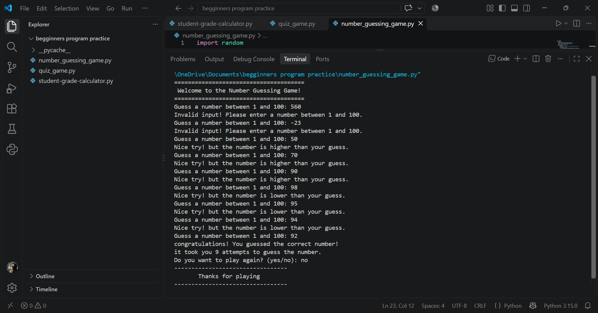

🎯 Number Guessing Game — Python

About the Project :

This is a simple Number Guessing Game I built while practising Python.

The computer picks a random number between 1 and 100, and the player has to guess it. After each guess, the game tells the player whether the number is too high or too low, making it easier to find the correct answer.

I also added an attempt counter to keep track of the guesses and a Play Again option so the player can start another round without restarting the program manually.

It was a good way for me to practise the Python concepts I have been learning and use them to build something interactive.

Features :

- Generates a random number between 1 and 100.
- Gives hints when a guess is too high or too low.
- Checks whether the guess is within the allowed range.
- Counts the number of attempts.
- Lets the player play another round.
- Validates the Play Again response and accepts "yes" or "no".
- Case-Insensitive Input: Accepts yes and no in uppercase or lowercase, such as YES, Yes, or yes.

Python Concepts Used :

- Variables and user input
- "random" module
- "while" loops
- "if", "elif", and "else"
- Functions
- Comparison operators
- Counters
- String methods such as ".lower()"
- Input validation

How to Run :

1. Install Python if it is not already installed.

2. Download or clone this repository.

3. Open the project folder in your terminal.

4. Run the Python file:

python number_guessing_game.py

Replace the filename with the actual name of your Python file if it is different.

5. Follow the instructions and try to guess the number!

What I Learned :

While building this game, I got more practice with loops, conditions, functions, and user input. I also worked on counting attempts, checking the player's input, and giving hints based on each guess.

Adding the Play Again option was another useful part of the project because it helped me practise organising my code into functions and repeating the game based on the player's choice.

I'm continuing to learn Python by building small projects like this and understanding how different concepts work together.

Author :

A Computer Science student learning Python through practice and projects.